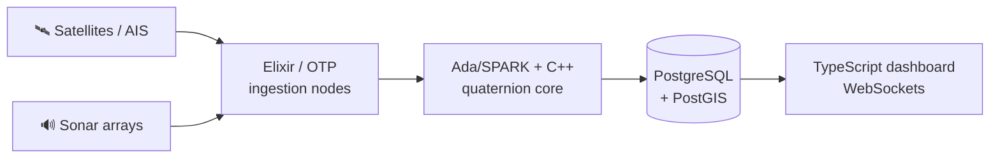
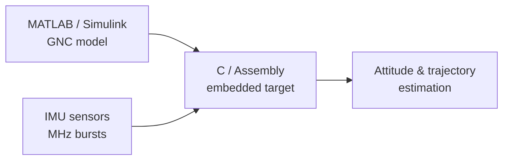

<!-- ═══════════════════════════════════════════════════════════════ -->
<!--                         HEADER / BANNER                         -->
<!-- ═══════════════════════════════════════════════════════════════ -->

<p align="center">
  
</p>

<p align="center">
  <a href="https://github.com/DLBKTe">
    
  </a>
</p>

<p align="center">
  
  
  
  
</p>

---

## `$ whoami`

```ada
--  SPARK 2014 — identity contract
package Daniel_Borda with SPARK_Mode is

   type Domain is (Avionics, Naval_Navigation, Bio_Pharma, Distributed_Systems);

   Role       : constant String := "Senior Mission-Critical Systems Engineer";
   Focus      : constant String := "Fault-tolerant, formally verified, real-time software";
   Education  : constant String := "M.Sc. in progress — Embedded / Real-Time Systems";

   procedure Ship_Code (Input : Requirement)
     with Pre  => Is_Specified (Input) and Is_Traceable (Input),
          Post => Proven (Input) and No_Runtime_Errors and Deterministic;

end Daniel_Borda;
```

> 🔒 **Classified note:** Most of my mission-critical work (avionics, naval defense, pharmaceutical simulation) was built under NDA in on-premise and air-gapped environments.
> This profile is the **public hub** for my open-source tools and contributions.

---

## 🛡️ Core Domains

| | Domain | What I do |
|:-:|---|---|
| ✈️ | **Avionics & Aerospace** | High-assurance software aligned with **DO-178C / ED-12C**, GNC algorithms, attitude estimation, IMU data at MHz rates. |
| ⚓ | **Naval & Maritime Tracking** | Positioning cores, AIS triangulation, sonar/satellite telemetry ingestion with spatial indexing. |
| 🧬 | **Bio-Pharma Systems** | Stochastic in-silico simulation, fault-tolerant architectures under **FDA / GxP** compliance. |
| ⚡ | **Distributed Systems** | BEAM/OTP actor-model engines, millions of concurrent processes, Monte Carlo & Markov chains. |

---

## 🛰️ Technical Arsenal

### ⚓ Safety-Critical & Embedded
<p>
  
  
  
  
  
  
  
  
</p>

### 📐 GNC, Telemetry & Scientific Computing
<p>
  
  
  
  
  
  
</p>

### ⚡ Distributed Backend & Data
<p>
  
  
  
  
  
  
  
</p>

### 🎮 Game Engines & Real-Time Graphics
<p>
  
  
  
  
  
</p>

### 🌐 Control Interfaces & Web
<p>
  
  
  
  
</p>

| Category | Tools & Standards |
|---|---|
| **Formal Verification** | SPARK Pro · Frama-C · TLA+ · Static Analysis · Model Checking |
| **Protocols & Buses** | ARINC 429 · MIL-STD-1553 · CAN bus · Modbus · Ethernet/IP |
| **Standards & Quality** | DO-178C · MISRA C/C++ · IEC 62304 · ISO 26262 |

---

## 🧬 Architected Systems

<details open>
<summary><b>🚢 Maritime Tracking & Submarine Hydro-Coordinate Core</b></summary>
<br>

Backend for an autonomous maritime positioning and tracking system.

- **Numerical core** in **Ada/SPARK + C++** — earth-to-body frame transforms (yaw, pitch, roll) using passive quaternions, free of gimbal lock.
- **Real-time geospatial ingestion** (satellite + sonar) on **PostgreSQL/PostGIS** with concurrent **Elixir** nodes.
- **Operator dashboards** in **TypeScript + Tailwind**, streamed over WebSockets.


</details>

<details>
<summary><b>✈️ Flight Dynamics & Autonomous Navigation Engine</b></summary>
<br>

Trajectory estimation, aircraft attitude computation and spatial coordinate interpretation.

- Control and instrumentation modeled in **MATLAB/Simulink**.
- Real-time execution migrated to **military-grade embedded targets** in **C + Assembly**.
- Processes **IMU bursts at MHz rates** with deterministic timing.


</details>

<details>
<summary><b>🔬 Stochastic Pharma Simulation Engine</b></summary>
<br>

Scientific computing engine that simulates in-silico behavior and toxicity of chemical compounds before human trials.

- Distributed stochastic algorithms in **Rust + Python** predicting pharmacokinetics and side effects via cellular molecular models.
- Massive Monte Carlo / Markov chain parallelization on **BEAM**.
</details>

---

## 🔭 Research & Expertise

```text
[■■■■■■■■■■] Proof-driven development — formal verification under DO-178C
[■■■■■■■■■□] Signal processing & 3D kinematics — quaternions, Euler angles, frame transforms
[■■■■■■■■■□] High-concurrency real-time ingestion, tolerant to hardware faults
[■■■■■■■■□□] Stochastic simulation — Monte Carlo, Markov chains, PK/PD models
```

---

## 📊 Telemetry

<p align="center">
  
  
</p>

<p align="center">
  
</p>

<p align="center">
  
</p>

---

<p align="center">
  <code>// if it can fail, it will be proven not to.</code>
</p>

<p align="center">
  
</p>
